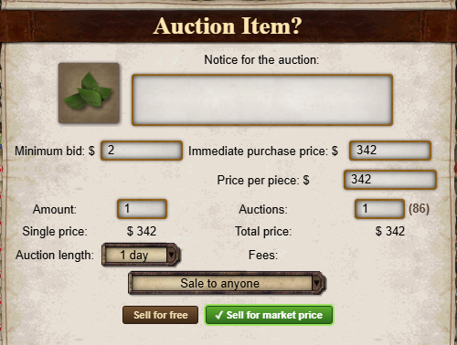
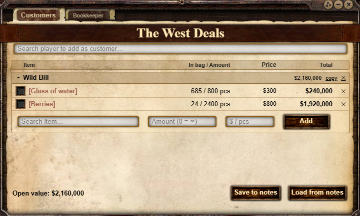
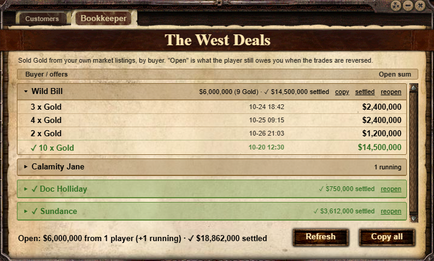
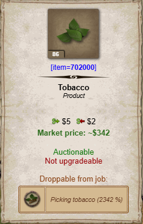
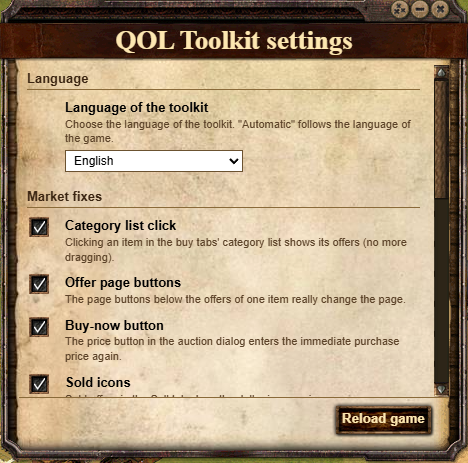

# The West QOL Toolkit

**Quality-of-life tools for the browser game [The West](https://www.the-west.net/).** One userscript that fixes annoying parts of the market, adds useful fields to the top bar, and helps you keep track of your deals. Every feature can be switched off individually in the settings.

> **Install in one click:** make sure [Tampermonkey](https://www.tampermonkey.net/) is installed, then press the green **Install** button above. Tampermonkey opens an install page; confirm it and reload the game. The script updates itself whenever a new version is published here.

## What you get

### Market fixes
- **Category list click** – clicking an item in the buy tabs' category list shows its offers right away (no more dragging).
- **Offer page buttons** – the page buttons below the offers of one item really change the page.
- **Buy-now button** – the price button in the auction dialog enters the *immediate purchase price* again, instead of suggesting the minimum bid.
- **Sold icons** – sold offers in the *Sell* tab show the dollar icon again.

### Sell dialog helper buttons

Two buttons under the "sell to anyone" dropdown of the sell dialog (the active one turns green and gets a checkmark):
- **Sell for free** – the immediate purchase price becomes the shop price of the whole stack (shop price × quantity) and follows quantity changes.
- **Sell for market price** – type a price per piece (pre-filled with the market price when known); the immediate purchase price is that price × quantity, the minimum bid is the shop price × quantity. If you edit a field yourself, the script stops overwriting it.

### Top bar
- **XP needed field** – shows the XP missing for the next level next to the coin. Click it for the XP gained today, a history of recent days, and an XP target (every day / until a date) with the daily XP you still need.
- **Money on the market field** – the money waiting for you from sold offers, with a tooltip and a click to refresh.

### Deals
**Customer deals** – a window to track product and item deals per customer: items, amounts, prices, running totals, copy-to-clipboard and save/load to your in-game notes. Search players by name to add them.

**Bookkeeper** – tracks who bought your Gold on the market and what each player still owes you, with *settled / reopen* handling for reversed trades.

### Market price of products
In the details popup of a product you see its **market price**: your hourly farming rate (default $8000/h, configurable) divided by the number of products you find in an hour-long job. Open any job window once so the script learns your product bonus; the highest value seen per product is cached, so prices are available without opening job windows again. Works together with TW Inventory Reloaded.

### Settings & languages
Open the settings with the gear-puzzle button added to the right-hand menu (or from the Tampermonkey menu). Switch features on and off and set your hourly rate. The script is available in **English** and **Hungarian (Magyar)**. The language follows the game's language automatically; you can override it in the settings. Changes apply after reloading the game.

## Installation
1. Install [Tampermonkey](https://www.tampermonkey.net/) (Chrome, Edge, Firefox, Safari, ...).
2. Click **[Install](https://raw.githubusercontent.com/hahahlolasd/TW-QOL-Toolkit/main/the-west-qol-toolkit.user.js)** and confirm in Tampermonkey.
3. Reload The West. The toolkit works on every world (`the-west.*`).

**Coming from the separate scripts?** The toolkit replaces *The West Market Fixer*, *The West Top Bar* and *The West Deals*. Disable or remove those to avoid duplicates. Script storage is per script, so the old customer list is offered for import on first start (answer *Yes* in the world it belongs to).

## Notes
- The game lists only the first ~100 of your market offers, so the "money on the market" sum can be lower than the real one in that case.
- The script only reads game data and fills in fields; it never buys, sells or collects anything on its own.

## License
Free to use and modify.
